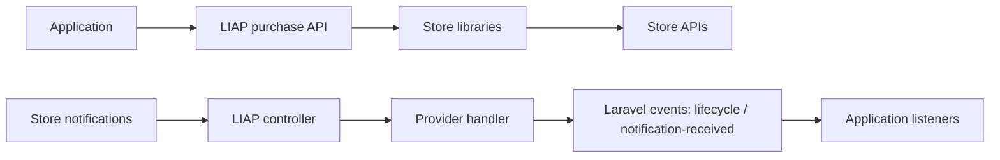

# Architecture

Laravel In-App Purchases (LIAP) integrates in-app purchases and subscription notifications with Laravel.
It builds on [Google Play Billing](https://github.com/imdhemy/google-play-billing) and
[App Store IAP](https://github.com/imdhemy/appstore-iap), which provide store API clients and provider-specific
receipt and notification types. LIAP adds facades, configuration, container bindings, console commands,
and an HTTP endpoint that dispatches events to the consuming application.

## Code map

Most package code lives under the `Imdhemy\Purchases` namespace in `src/`.

| Location                                             | Responsibility                                                                                                                                                         |
|------------------------------------------------------|------------------------------------------------------------------------------------------------------------------------------------------------------------------------|
| `ServiceProviders`                                   | Laravel integration. `LiapServiceProvider` registers bindings, configuration, routes, and commands; `EventServiceProvider` registers configured application listeners. |
| `Facades`, root `Product` and `Subscription` classes | Purchase API entry points. Facades resolve the root classes, which configure and delegate operations to the store libraries.                                           |
| `Http/Controllers`, `routes`                         | Notification HTTP entry point. `ServerNotificationController` delegates to a handler selected by `HandlerFactory`.                                                     |
| `Handlers`                                           | Provider selection, request authorization and validation, payload processing, and event dispatch. `JwsService` adapts App Store JWS parsing and verification.          |
| `ServerNotifications`, `Subscriptions`               | Adapters around provider-specific notification and subscription data for the package contracts.                                                                        |
| `Events`                                             | Lifecycle events, event factories, and `FallbackEvent` for notification types without a matching event class.                                                          |
| `Domain/Event`, `Domain/Model`                       | Notification-received events and their provider-specific payload objects, alongside the lifecycle event API.                                                           |
| `Contracts`                                          | Shared interfaces for notifications, subscriptions, purchase events, event creation, and URL generation.                                                               |
| `Console`, `Services`                                | Integration utilities, including notification URL generation, configuration publishing, and requesting App Store test notifications.                                   |
| `config/liap.php`                                    | Defaults for routing, provider settings, and application event listeners.                                                                                              |
| `tests/Feature`                                      | Notification handling examples for Google Play and both App Store notification formats. Other test directories cover individual components.                            |

## Main flows

### Purchase operations

Application code calls the `Product` or `Subscription` facade, selects a store, and supplies purchase identifiers
or receipt data. The corresponding root class uses configuration and the store library to perform the operation.
Results are provider-library response objects; `Subscription::toStd()` adapts subscription data to
`SubscriptionContract` through the classes in `Subscriptions`.

### Incoming notifications

1. The registered notification route invokes `ServerNotificationController`.
2. `HandlerFactory` selects a handler from the request's `provider` query parameter. An App Store request with
   `signedPayload` selects the V2 handler.
3. `AbstractNotificationHandler` runs authorization, request validation, and provider-specific handling.
   The App Store V2 handler also verifies the signed payload through `JwsService`.
4. The handler constructs notification or payload objects and dispatches Laravel events. Lifecycle events are
   selected by `Events\EventFactory` from the provider and notification type.
5. Application listeners react to those events and apply application-specific behavior.

### Two event models

`Events` represents lifecycle notifications as specific event classes, such as subscription renewal or
cancellation. These events wrap a `ServerNotificationContract`; the factory uses `FallbackEvent` when no matching
event class exists.

`Domain/Event` exposes `AppStoreNotificationReceivedEvent` and `GooglePlayNotificationReceivedEvent`. Their payload
objects carry the App Store signed payload or Google Play message rather than a lifecycle-specific event type.
The `Domain` directory therefore describes part of the notification API, not a complete separation from Laravel.

The two models currently coexist. App Store V2 test notifications emit only the notification-received event;
other V2 notifications emit a lifecycle event followed by the notification-received event. Google Play
subscription notifications emit both, while its test notifications and messages that fail the handler's
parsability check emit the notification-received event. The legacy App Store handler emits lifecycle events only.
Consumers must not assume every incoming request emits both event models.

## Boundaries and compatibility

The store libraries supply provider API operations and payload interpretation. LIAP connects those capabilities
to Laravel requests, services, and events. Application listeners are the integration boundary for business behavior
such as updating access to purchased content.

The current structure mixes technical folders with the newer `Domain` namespace. Existing classes also include
non-final types and protected members that applications may extend. Changes to those classes or to emitted events
need compatibility review; their presence alone does not define a supported extension contract.

## Cross-cutting concerns

- **Container wiring:** `LiapServiceProvider` binds the facades and interfaces used by handlers, URL generation,
  event creation, and JWS processing.
- **Configuration:** the provider merges package defaults with application configuration. Routing options control
  the route prefix, middleware, and optional Laravel URL signature checks. `EventServiceProvider` reads
  `liap.eventListeners` to register listeners.
- **Authorization and verification:** Laravel URL signature checks and App Store V2 payload verification are
  separate checks. The former is configurable; the latter runs in the V2 handler's authorization step.
- **Failures:** authorization, validation, parsing, and provider-operation exceptions can propagate to Laravel or
  the caller. A lifecycle `FallbackEvent` handles an unmapped event type; it is not a general error handler.

## Evolution

We are gradually exploring a structure that makes the package's business capabilities and use cases easier to recognize.

`docs/design-notebook/` records individual experiments, findings, and design decisions. These documents support
discovery; proposals describe possibilities until implemented.

Contributors, including coding agents, should update `ARCHITECTURE.md` whenever a change affects the responsibilities,
boundaries, or main flows described here. Keep this file aligned with the implemented system and record exploratory
reasoning in the design notebook.
